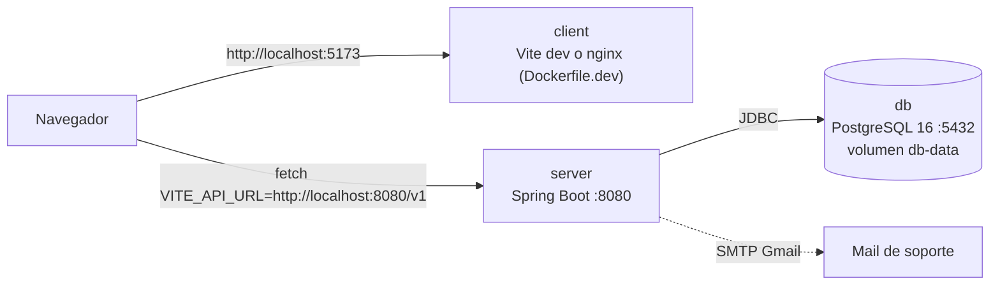
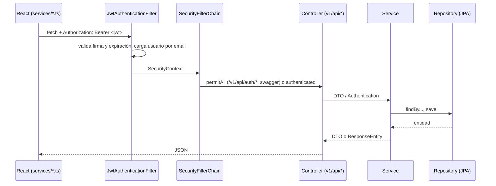
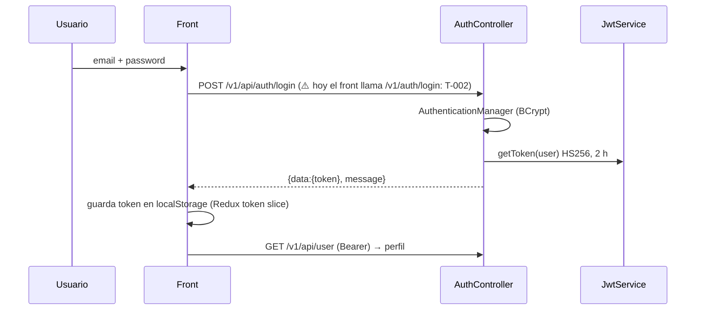

# Arquitectura

## Componentes (local)



`docker compose up -d --wait` levanta solo `db`; con `--profile app` también `server` y `client`. Producción original: back en Render (`backend/AwareGaming/Dockerfile`), front en Firebase Hosting.

## Flujo de una request



## Autenticación



Stateless, sin refresh token. Roles `USER`/`ADMIN` existen en el modelo pero **no se usan** para autorizar (T-006). Secreto JWT en el código (T-007).

## Modelo de datos

```mermaid
erDiagram
  USER ||--o{ POST : escribe
  USER ||--o{ COMMENT : escribe
  POST ||--o{ COMMENT : tiene
  USER ||--o{ RECORD_BY_GAME : juega
  USER ||--o{ SUPPORT_CONTACT : envia
  USER { int idUser PK; string email UK; string dni UK; string password; int credits; int age; string role; bool isActive }
  POST { int idPost PK; string title; string description; datetime created_at; datetime updated_at }
  COMMENT { int idComment PK; string comment; bool isDeleted; datetime createdAt; datetime updatedAt }
  RECORD_BY_GAME { long id PK; string bet_type; int bet_amount; int bet_number; int winning_number; string result }
  GAME { int id PK; string name; list features; list rules }
  SUPPORT_CONTACT { int idSupportContact PK; string email; string subject; string description }
```

Esquema por `ddl-auto=update` (sin migraciones). Identificadores entre comillas (`globally_quoted_identifiers=true`).

## Endpoints principales (`/v1/api`)

| Método y ruta | Pantalla que lo usa | Notas |
|---|---|---|
| `POST /auth/register` · `POST /auth/login` | `RegisterForm`, `LoginForm` | públicos; ⚠️ el front usa `/auth/*` sin `/api` (T-002) |
| `GET /user` | `DashboardPage` (perfil) | usuario del token |
| `PUT /user/{id}` | `EditProfileForm` | sin chequeo de dueño (T-006) |
| `GET /user/all`, `GET/DELETE /user/{id}`, `POST /user/credits`, `POST /user/credits-by-id` | — | deberían ser de admin (T-006) |
| `POST /game/play-roulette` | `RoulletePage` | sin validación de monto (T-008) |
| `POST /game/play-dice` | — (Dice Aware sin UI) | pago incorrecto (Backlog P2) |
| `GET/POST/DELETE /game` | — | expone la entidad `Game` |
| `GET /record-game`, `GET /record-game/all` | — | historial de ruleta |
| `/posts/*`, `/comment/*` | — (el foro muestra datos fijos) | Backlog P2 |
| `POST /support` | — | envía mail (SMTP) |

Contrato: OpenAPI en `/v3/api-docs`, UI en `/swagger-ui/index.html`.

## Arquitectura objetivo

- Autorización por rol y por dueño; errores con `ProblemDetail` y códigos correctos (T-006, T-009).
- Configuración 100 % por entorno: secreto JWT, CORS, SMTP (T-007, T-016).
- Migraciones con Flyway en lugar de `ddl-auto=update` (Backlog P1, con ADR).
- Spring Boot 3.5 → 4.x y Java 21 de target; front con React 19 y Vite actual (P1).
- ADRs en `docs/adr/` (plantilla en `docs/agents/templates/adr.md`): el primero lo escribe T-005 (Testcontainers en vez de H2).
